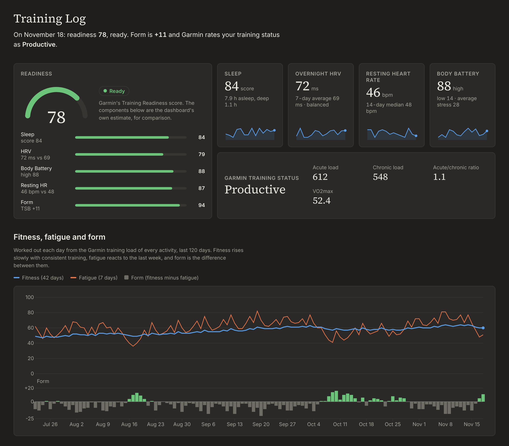
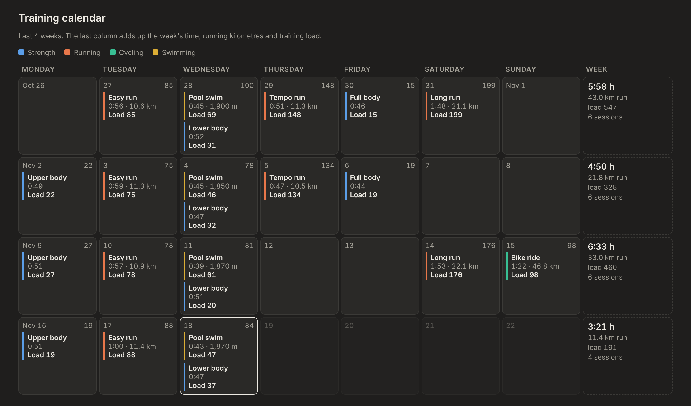

# Training Log: a Garmin dashboard in Claude

A TrainingPeaks-style training dashboard built from your Garmin Connect data. It updates itself several times a day and opens in Claude, on your computer and on your phone.





<sub>Screenshots show invented sample data, not a real athlete.</sub>

## What's on the dashboard

- **Today's readiness**: Garmin's Training Readiness score if your watch computes it, otherwise the dashboard's own estimate from sleep, HRV, Body Battery, resting heart rate and form, with how much each one contributes.
- **Sleep, HRV, resting heart rate and Body Battery**, each with its 14-day trend.
- **Garmin training status** (productive, maintaining and so on), acute and chronic load, VO2max.
- **Fitness, fatigue and form** over 120 days, worked out from Garmin training load.
- **A 4-week calendar** with every session, its duration, distance and load.
- **Weekly volume** by sport and **running progress** (pace and aerobic efficiency).
- **A table** of recent activities.

## How it works

```
Garmin watch ──► Garmin Connect ──► script on your laptop ──► Google Drive ──► dashboard in Claude
                                     (runs every 3 hours)                       (reads the files each time it opens)
```

Your data stays in your own accounts: Garmin, Google Drive and Claude. The project has no server of its own and sends nothing anywhere else.

## What you need

- A **Garmin watch** that syncs with Garmin Connect.
- A laptop or PC with **Windows 10 or 11**.
- **Google Drive for desktop** ([google.com/drive/download](https://www.google.com/drive/download/)), signed in with the Google account you connect to Claude.
- A **Claude** plan (Pro or Max) with Claude Code, and the **Google Drive** connector turned on at [claude.ai/customize/connectors](https://claude.ai/customize/connectors).

## Setup

### 1. On your laptop (once, about 5 minutes)

1. Open **PowerShell**: press Start, type `PowerShell` and press Enter. A normal window is fine, you don't need administrator rights.
2. Paste this command and press Enter:
   ```powershell
   powershell -ExecutionPolicy Bypass -c "irm https://raw.githubusercontent.com/alexandrubancioiu/garmin-dashboard/main/install.ps1 | iex"
   ```
   It downloads the latest version of this project into a temporary folder and runs [`setup.ps1`](setup.ps1) from it. You can read [`install.ps1`](install.ps1) first: it is a few lines long.
3. When asked, enter your Garmin Connect email and password and, if you use two-step verification, the code Garmin sends you. Your password is not stored anywhere: only the session tokens are kept, in `%USERPROFILE%\.garminconnect`, and they last about 6 months.

<details>
<summary>Prefer to download it yourself?</summary>

1. At the top of this page: **Code → Download ZIP**, then extract the folder.
2. Open the extracted folder, type `powershell` in File Explorer's address bar and press Enter.
3. Run:
   ```powershell
   powershell -ExecutionPolicy Bypass -File .\setup.ps1
   ```
</details>

When it finishes, Google Drive has a `My Drive\garmin-dashboard` folder with three files, and Windows runs the export by itself at 07:12 and then every 3 hours, with no window. If the laptop was off at the scheduled time, the export runs as soon as you turn it on.

### 2. The dashboard in Claude (once, about 2 minutes)

1. Click **Fork** at the top of this page, so you have your own copy of the project on GitHub.
2. Open [claude.ai/code](https://claude.ai/code), pick your copy (`garmin-dashboard`) and say:
   > build my Garmin dashboard
3. Claude finds your files in Google Drive and builds the dashboard in your account.
4. The first time you open the dashboard, allow it to use Google Drive.

That's it. From then on the dashboard shows the data from the latest export, on your phone too.

## FAQ

**The dashboard stopped updating.** Look at `%USERPROFILE%\garmin-dashboard\export.log`. The usual causes:
- *429 / too many requests*: Garmin is rate limiting for a while. The next export, 3 hours later, usually works.
- *a login error*: the tokens expired, about once every 6 months. Run:
  ```powershell
  & "$env:USERPROFILE\garmin-dashboard\.venv\Scripts\python.exe" "$env:USERPROFILE\garmin-dashboard\garmin_login.py" --force
  ```
- *Google Drive isn't running*: start the Google Drive app.

**My watch has no Training Readiness.** The dashboard then shows its own estimate and says so on the card. The formula is explained at the bottom of the dashboard, under "How the numbers are worked out".

**I want to change something on the dashboard.** Tell Claude what you want ("add a chart of kilometres per month", "make the cards bigger", "translate the dashboard to Spanish") and it changes it.

**How do I update to the latest version?** Run the install command from step 1 again. It replaces the scripts with the newest ones and keeps your Garmin login, your data and the schedule.

**How do I stop the automatic export?** Open **Task Scheduler**, find **Garmin dashboard export** and choose **Disable** or **Delete**. To remove everything, then delete the `%USERPROFILE%\garmin-dashboard` folder and the folder in Google Drive.

**Can I share my dashboard?** You can, but whoever gets the link sees your health data. For friends, send them the link to this project so they can build their own.

## Important

- This project uses the **unofficial** [python-garminconnect](https://github.com/cyberjunky/python-garminconnect) library, not an official Garmin API. Garmin can break it at any time and does not endorse this kind of access. Use it at your own risk, for your own account.
- This project is not affiliated with Garmin, Google or Anthropic.
- The readiness estimate and the form chart are the dashboard's calculations, not medical advice.

## Support the project

The project is free and open source. If it's useful to you and you'd like to support it, you can send a donation on Revolut: **[revolut.me/alexz4ai5](https://revolut.me/alexz4ai5)** (no Revolut account needed, a card works too). Thank you!

## Thanks

- [python-garminconnect](https://github.com/cyberjunky/python-garminconnect) by Ron Klinkien (MIT), for access to Garmin Connect.
- [garmin_mcp](https://github.com/Taxuspt/garmin_mcp) by Alexandre Domingues (MIT), where the idea started.
- [uv](https://github.com/astral-sh/uv) and [D3](https://d3js.org).

## License

[MIT](LICENSE)
